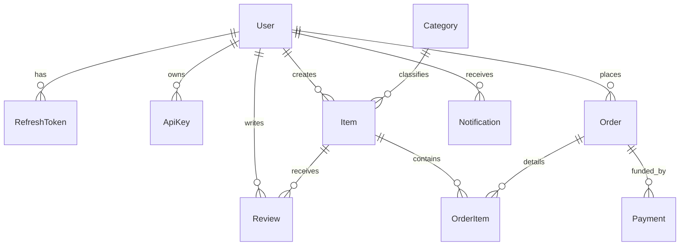

# Backend Arsenal — Universal Data Models

All 10 stacks use these uniform data schemas. All primary keys are UUID strings. Monetary amounts are stored as integers in minor currency units (e.g. 1000 = ₹10.00).

## Schema Definitions

### 1. User
- `id` (UUID, PK)
- `name` (String, required)
- `email` (String, unique, lowercase, indexed)
- `passwordHash` (String, required)
- `role` (Enum: `admin`, `manager`, `user`, default: `user`)
- `avatar` (String, nullable)
- `phone` (String, unique, nullable)
- `bio` (Text, nullable)
- `isActive` (Boolean, default: true)
- `emailVerifiedAt` (DateTime, nullable)
- `lastLoginAt` (DateTime, nullable)
- `failedLoginCount` (Integer, default: 0)
- `lockedUntil` (DateTime, nullable)
- `twoFactorSecret` (String, nullable)
- `twoFactorEnabled` (Boolean, default: false)
- `createdAt` (DateTime, default: UTC now)
- `updatedAt` (DateTime, default: UTC now)

### 2. Category
- `id` (UUID, PK)
- `name` (String, unique, required)
- `slug` (String, unique, required, indexed)
- `description` (Text, nullable)
- `parentId` (UUID, FK -> Category.id, nullable)
- `createdAt`, `updatedAt`

### 3. Item (Generic Core Entity)
- `id` (UUID, PK)
- `title` (String, required, indexed)
- `description` (Text, required)
- `price` (Integer, minor units, required)
- `currency` (String, default: "INR")
- `categoryId` (UUID, FK -> Category.id, indexed)
- `images` (JSON Array of URLs)
- `rating` (Float, default: 0.0)
- `ratingCount` (Integer, default: 0)
- `stock` (Integer, default: 0)
- `status` (Enum: `draft`, `active`, `archived`, default: `active`, indexed)
- `lat` (Float, nullable)
- `lng` (Float, nullable)
- `viewCount` (Integer, default: 0)
- `likeCount` (Integer, default: 0)
- `createdBy` (UUID, FK -> User.id)
- `deletedAt` (DateTime, nullable, indexed)
- `version` (Integer, default: 1)
- `createdAt`, `updatedAt`

### 4. Tag & ItemTag
- Tag: `id`, `name` (unique)
- ItemTag: `itemId` (FK), `tagId` (FK), Composite PK (`itemId`, `tagId`)

### 5. Review & Comment
- Review: `id`, `itemId` (FK), `userId` (FK), `rating` (1-5), `comment`, Unique(`itemId`, `userId`)
- Comment: `id`, `itemId` (FK), `userId` (FK), `parentId` (nullable FK), `body`

### 6. Cart & CartItem
- Cart: `id`, `userId` (unique FK), `couponId` (nullable FK)
- CartItem: `id`, `cartId` (FK), `itemId` (FK), `quantity` (Int), `unitPrice` (Int)

### 7. Order & OrderItem
- Order: `id`, `userId` (FK), `status` (`pending`, `paid`, `shipped`, `delivered`, `cancelled`), `subtotal`, `discount`, `tax`, `total`, `currency`, `shippingAddress` (JSON)
- OrderItem: `id`, `orderId` (FK), `itemId` (FK), `title`, `unitPrice`, `quantity`

### 8. Payment & WebhookEvent
- Payment: `id`, `orderId` (FK), `provider` (`mock`, `razorpay`, `stripe`), `providerOrderId`, `providerPaymentId`, `amount`, `currency`, `status` (`created`, `pending`, `succeeded`, `failed`, `refunded`), `idempotencyKey`
- WebhookEvent: `id`, `provider`, `eventId` (unique), `type`, `payload` (JSON), `processedAt`

### 9. Booking
- `id`, `itemId` (FK), `userId` (FK), `startsAt` (DateTime), `endsAt` (DateTime), `status` (`confirmed`, `cancelled`)

### 10. Notification, AuditLog, FileRecord
- Notification: `id`, `userId` (FK), `title`, `message`, `type` (`info`, `success`, `warning`, `error`), `isRead` (Bool), `data` (JSON)
- AuditLog: `id`, `actorId` (nullable FK), `action`, `entity`, `entityId`, `ip`, `userAgent`, `meta` (JSON), `createdAt`
- FileRecord: `id`, `ownerId` (FK), `originalName`, `storedName`, `mime`, `size`, `url`, `driver` (`local`, `s3`, `cloudinary`)
